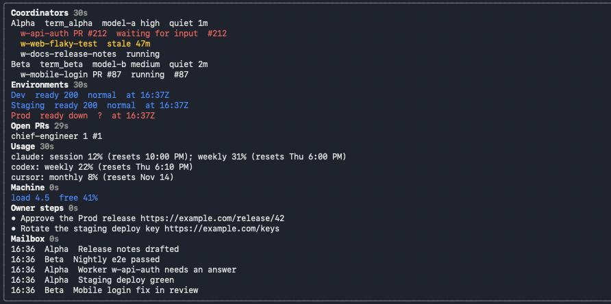

# chief-engineer

A Claude Code mod for whoever runs several coordinators and their workers at once.
It keeps one sidebar beside the chat with the seven things a chief checks all
day, live, and a one-line band above the prompt while the pane is closed.



## Install

From a shell:

```
claude plugin install chief-engineer --marketplace ogarciarevett/chief-engineer --scope user --config configPath=$HOME/.config/chief-engineer/config.json
```

Or at the prompt of a session: `/plugin install chief-engineer --marketplace ogarciarevett/chief-engineer`
(answer `y` to add the marketplace, then pick a scope).

Then write the config at that path and edit it (see the config reference below):

```
mkdir -p ~/.config/chief-engineer
curl -fsSL https://raw.githubusercontent.com/ogarciarevett/chief-engineer/main/config.example.json -o ~/.config/chief-engineer/config.json
```

Keep it outside any repo. To change the path later,
use `/config` (field `Config file` of `chief-engineer`) or `~/.claude/settings.json`:

```json
{ "pluginConfigs": { "chief-engineer": { "options": { "configPath": "/absolute/path/config.json" } } } }
```

Start a session. The panel opens inline above the prompt; `/chief` opens it at any
time. For the sidebar on the right of the chat, start it fullscreen in a terminal
at least 110 columns wide:

```
CLAUDE_CODE_NO_FLICKER=1 claude
```

To run it from a checkout instead: `claude --plugin-dir /path/to/chief-engineer`.

## What it shows

1. **Coordinators**: one row per coordinator (name, terminal handle, model and
   effort, minutes since its last output), with its workers underneath: task name,
   state (waiting for permission, waiting for input, stale for N minutes, running,
   done, failed) and PR number. Workers are the coordinator's dispatched tasks plus
   every agent terminal under its `worktrees` (title and state only). A worker name
   shows once, with its newest state; done workers fold into one `+N done` line.
   A coordinator or worker whose screen shows a permission dialog is red and
   listed first. Input rows are red, stale rows are yellow.
2. **Environments**: per environment, the HTTP code of `/ready`, the state field of
   the status endpoint, and the time of the last check.
3. **Open PRs** per repo: count and numbers; a PR older than 24 hours is yellow.
4. **Usage**: the key percentages (`session 12%`, `weekly 31%`) of your usage
   command for the providers you name, with known reset times; other detail is
   dropped.
5. **Machine**: load average and free memory percent. Green under load 20 with
   over 40 % free, red above load 30 or under 25 % free, yellow between.
6. **Owner steps**: every open `- ` item of a Markdown file you maintain; `- [x]`
   items are hidden.
7. **Mailbox**: the last 5 messages of an append-only JSONL file (time, sender,
   subject). Message bodies are never shown.

Every section header shows an icon, the age of its last good read, and toggles the
section open or closed. A read that fails keeps the last value and adds a yellow
`⚠ stale:` note; it never closes the pane. The top row sums up what needs you and
has a refresh button (`r` while the pane has the keyboard). PR numbers and owner
step URLs are links. A cut-off row (an owner step, a worker, a repo) shows in full,
wrapped, when you click it or select it and press Enter; press it again to cut it.

The panel opens inline above the prompt by default. The right dock needs Claude
Code's fullscreen layout: start the session with `CLAUDE_CODE_NO_FLICKER=1` in a
terminal at least 110 columns wide. A dock on the left is not possible in Claude
Code 2.1.309; a mod cannot move it. Under 44 columns of pane width the secondary
columns (handles, models, times, meters) drop out.

## Config reference

| Field | Default | Meaning |
| --- | --- | --- |
| `pollSeconds` | `60` | Interval for remote reads (workers, environments, PRs, usage). Never under 30. Local reads (machine, owner steps, mailbox, config) run every 10 s. |
| `staleMinutes` | `30` | A dispatched worker whose terminal is quiet longer than this is stale. |
| `coordinators` | `[]` | `{ name, terminal?, run?, model?, worktrees? }`. `terminal` is the Orca terminal handle; `run` is the orchestration Run that holds its tasks; `worktrees` is a list of path prefixes whose agent terminals count as its workers. |
| `workersCommand` | `orca orchestration task-list --run {run} --status dispatched --brief --json` | Argv that lists a coordinator's live tasks; `{run}` is replaced. A worker that leaves this list shows as done for an hour. Output over 4 MiB is refused, so keep the filter. |
| `terminalsCommand` | `orca terminal list --json` | Argv that lists terminals with `lastOutputAt`. The output preview is used only to detect a waiting prompt and is never shown or stored. |
| `screenCommand` | `orca terminal read --terminal {handle} --screen --json` | Argv that reads the rendered screen of a shown terminal, once per remote poll, to detect a permission dialog (`Do you want to proceed?`, `Esc to cancel`, `Allow command?`, trust prompts) in its last 20 rows. Only the match leaves the reader; the screen is never shown or stored. |
| `environments` | `[]` | `{ name, url }`, http or https. |
| `readyPath` | `/ready` | Path whose HTTP code is shown. |
| `statusPath` | `/v1/system/status` | Path that returns JSON with the state. |
| `statusField` | `state` | Field of that JSON to show. |
| `repos` | `[]` | `owner/repo` names; read with `gh pr list` (your own `gh` login). |
| `usageCommand` | `[]` | Argv of a command that prints one `provider: ...` line per provider. Empty hides the section. |
| `usageProviders` | `[]` | Providers to keep from that output; empty keeps every line. |
| `mailbox` | `""` | Path (`~/` allowed, as for `ownerSteps`) of a JSONL file with `{ at, from, subject }` per line. `from` values that match a coordinator's `terminal` show its name. |
| `ownerSteps` | `""` | Path of the Markdown file of open owner steps. |

## Rules it keeps

- Read-only commands only: `orca ... list`, `orca terminal read --screen`, `gh pr list`, `sysctl`, `memory_pressure`,
  `tail`, your usage command, and HTTP GETs.
- No paid API calls and no hosted service.
- It never shows message bodies, terminal output or environment variables.
- Phone-like numbers in any drawn text are masked as `[number]`, and an error
  from unreadable output is shown as `output not readable`, never quoted.
- Reads run on timers outside the prompt, so the prompt never waits for them.

## Status

Implemented and covered by `claude plugin test` (21 tests):

- Config parsing, defaults and validation; one assert-based test per data reader
  (workers, terminal workers, worker merge, permission dialogs, environments, PRs,
  usage, machine, owner steps, mailbox).
- Section headers collapse and reopen their section; a cut-off row opens in full
  and closes again; PR numbers link to GitHub.
- The pane draws all seven sections from a config on the terminal and desktop
  surfaces; only the allowed read-only commands run.
- An environment that does not answer shows as down instead of failing.
- A section whose first read fails shows the error; a status page that is not
  JSON reads as `?`; a section with no source in the config is hidden; a worker that leaves the
  dispatched list shows as done for an hour.
- The band summary while the pane is closed.

Pending:

- Coordinator context percent: not shown; no cheap read-only source yet.
- Machine readings use macOS tools (`sysctl vm.loadavg`, `memory_pressure`); Linux
  is not supported yet.
- Done is not split from failed for workers that leave the dispatched list.
- Sections cut long lines to the pane width; the pane scrolls with the arrows while it has the keyboard.
- The dock side is Claude Code's: right of the chat in 2.1.309; left is not possible.

## Credits

Patterns (state atoms read while drawing, `$.clock.every` polling, tests that stand
in for `process.run` and `fs.read`) follow the MIT-licensed mods in
[hamzafer/claude-code-mods](https://github.com/hamzafer/claude-code-mods),
especially `mission-control`. No code was copied.

## Licence

MIT
